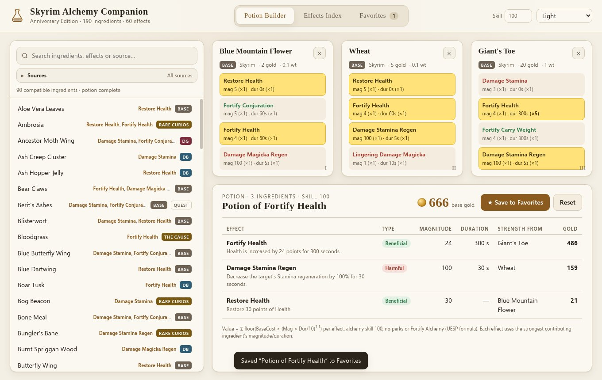
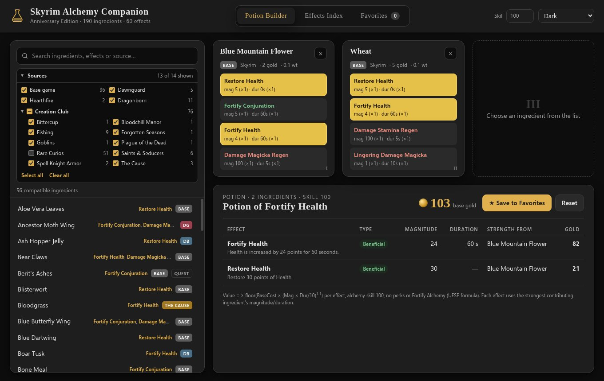

# Skyrim Alchemy Companion

An offline desktop potion builder and effects index for **The Elder Scrolls V: Skyrim Anniversary Edition**. Pick ingredients and see the resulting potion's effects, strength and gold value. It covers all 190 ingredients, including Dawnguard, Hearthfire, Dragonborn and the Creation Club content. The app is built with Electron for Windows x64, runs fully offline and has no telemetry.

- **To build it yourself from source, see [BUILDING.md](BUILDING.md).**
- **License:** MIT for the code (see [LICENSE](LICENSE)). The ingredient data is CC BY-SA 2.5, from UESP (see [Credits](#credits)).

| Light | Dark |
|---|---|
|  |  |

## Running it (Windows)
1. Unzip `SkyrimAlchemyCompanion_win.zip` anywhere, for example to `C:\Games\SkyrimAlchemyCompanion`.
2. Open the `Skyrim Alchemy Companion-win32-x64` folder and run **`Skyrim Alchemy Companion.exe`**.
   You don't need to install anything, and you don't need an internet connection.
3. The app isn't code-signed, so Windows SmartScreen may warn you the first time you run it. Click **More info → Run anyway**.

Favorites are saved to `%APPDATA%\Skyrim Alchemy Companion\favorites.json`.

## Features
- **Potion Builder.** Search the list of all 190 ingredients, each with a source tag. Pick up to 3 ingredients:
  - **Sources** (collapsible panel above the list): one checkbox per source – Base game, Dawnguard, Hearthfire, Dragonborn, and each Creation Club source grouped under a collapsible "Creation Club" section with a master toggle. All are checked by default. Unchecking a source hides its ingredients from the list and from the compatible-ingredient filtering; ingredients you already selected stay selected. Your choices are remembered between launches.
  - After each pick, the list narrows to ingredients that share at least one effect with what you've already chosen.
  - Effects shared by two or more of your ingredients are highlighted in yellow.
  - The bottom panel shows the resulting potion or poison: each effect's magnitude and duration, which ingredient sets its strength, the gold value per effect and the total base gold.
  - You can remove a single ingredient (×), Reset everything, or use **Save to Favorites**.
- **Effects Index.** A searchable list of all 60 effects, which you can filter to beneficial or harmful only. Click an effect to expand it and see every ingredient that has it, with that ingredient's base magnitude and duration (non-standard values are highlighted), its source, the effect's slot (1st–4th) and its gold value.
- **Favorites.** Saved combinations show their ingredients, effects and value. You can load a favorite back into the builder or delete it.
- **Theme.** The app follows the Windows light/dark setting by default (dark mode is black and grey). You can override it with the theme selector.
- **Alchemy skill** (15–100, default 100, matching the UESP tables) feeds into magnitudes and gold values.

## How potion values are calculated
The app uses UESP's formula (Skyrim:Alchemy Effects → Strength Equations), with **no perks and no Fortify Alchemy**:

```
Magnitude  = round(BaseMag * 4 * (1 + Skill/200))      (for effects UESP marks as duration-scaling – Invisibility,
                                                        Paralysis, Slow, Waterbreathing, Damage Magicka/Stamina Regen,
                                                        Light, Night Eye, Spell Absorption – the duration scales instead)
EffectGold = floor(BaseCost * (max(Mag,1) * (Dur>0 ? Dur/10 : 1)) ^ 1.1)
PotionGold = sum of EffectGold over all active effects
```

- An effect is active when at least 2 of the selected ingredients share it.
- Each active effect takes its magnitude and duration from the contributing ingredient whose version of that effect is worth the most gold. UESP describes this as the "highest priority ingredient" rule.
- The strongest effect decides the name and whether the result is a Potion or a Poison.
- As a check, the standard value at skill 100 calculated for every effect matches the value column of UESP's Alchemy Effects table (see `tests/logic.test.js`).

## Data
The data is stored in `app/data/alchemy.json` and was generated from en.uesp.net with `scripts/fetch_uesp.py` and `scripts/build_data.py`, using the MediaWiki API:
- *Skyrim:Ingredients*: the ingredient list, including the Creation Club and quest sections.
- Each ingredient's page: value, weight, its 4 effects in order, and any non-standard magnitude/duration/gold multipliers.
- *Skyrim:Alchemy Effects*: base cost, base magnitude, base duration and description for each effect.
- The effect pages, used to cross-check those values and to read explicit per-ingredient tables (for example, Damage Health).

### What's included (190 ingredients)
| Source | Count |
|---|---|
| Base game (91 standard ingredients + 4 quest items: Berit's Ashes, Farengar's Frost Salt, Fine-Cut Void Salts, Jarrin Root) | 95 |
| Aloe Vera Leaves (official `_ResourcePack.esl`, patch 1.6.1130) | 1 |
| Dawnguard | 5 |
| Hearthfire | 2 |
| Dragonborn | 11 |
| Rare Curios | 51 |
| Fishing | 9 |
| Saints & Seducers (including Rot Scale, Screaming Maw and Thorn Hook, whose records ship in Update.esm) | 6 |
| The Cause | 3 |
| Spell Knight Armor (quest hearts) | 2 |
| Bittercup, Plague of the Dead, Goblins, Forgotten Seasons, Bloodchill Manor (Nightshade variant) | 1 each |

According to UESP's list, Survival Mode, The Gray Cowl of Nocturnal and the other AE Creations add **no** alchemy ingredients.

### Values that couldn't be verified directly (marked ≈ in the app)
For 17 ingredient/effect pairs, UESP gives a gold multiplier that the documented magnitude/duration multipliers don't explain. In each case a hidden magnitude or duration was worked out from that gold multiplier:
- Cure Disease: Charred Skeever Hide, Hawk Feathers, Chokeweed, Hunger Tongue, Red Kelp Gas Bladder, Scrib Jelly, Withering Moon (mag 2)
- Cure Poison: Ambrosia (mag 3)
- Ravage Health: Chokeberry, Congealed Putrescence, Daedra Venin, Gold Kanet (duration 20)
- Ravage Stamina: Deathbell, Bungler's Bane, Hypha Facia (duration 20)
- Slow: Rot Scale (mag 5)
- Regenerate Health: Screaming Maw (duration 10)

Other notes:
- Glassfish's 4th effect, *Fortify Persuasion*, isn't in any other ingredient, so it can never be brewed. It's listed but excluded from matching.
- UESP rounds some multipliers to 2 decimal places, so magnitudes and durations were rounded to whole numbers (game data uses whole numbers). Example: Salmon Roe's Fortify Magicka duration comes out as 5 s.
- The rule that the strongest ingredient sets the strength follows UESP's description. UESP itself says the game's priority is only *believed* to be the effect cost.
- The full list of notes is in `alchemy.json` under `meta.notes`.

## Developing
Requires Node.js 22 LTS (≥ 22.12). Full Windows build instructions are in [BUILDING.md](BUILDING.md).
```
npm install            # install the pinned dependencies (electron 33.4.11, @electron/packager 20.3.0, resedit 3.1.0)
npm start              # run the app
npm test               # logic tests
npm run package:win    # build dist\Skyrim Alchemy Companion-win32-x64\ and embed assets\icon.ico into the .exe
npm run data:fetch     # optional: re-download the source pages from UESP (Python 3)
npm run data           # optional: rebuild app/data/ from the downloaded pages
```

## Privacy
The app makes no network requests at runtime and has no telemetry, analytics or auto-update. Favorites are stored only on your PC, in `%APPDATA%\Skyrim Alchemy Companion\favorites.json`.

## Credits
- **Ingredient and effect data** come from the **Unofficial Elder Scrolls Pages (UESP)**, https://en.uesp.net, in particular the *Skyrim:Ingredients* and *Skyrim:Alchemy Effects* pages and the individual ingredient pages. UESP content is licensed under **[Creative Commons Attribution-ShareAlike 2.5 (CC BY-SA 2.5)](https://creativecommons.org/licenses/by-sa/2.5/)**. The derived data files in `app/data/` are shared under the same license. Many thanks to the UESP editors.
- The potion strength and value formulas follow UESP's *Skyrim:Alchemy Effects* documentation.
- *The Elder Scrolls V: Skyrim* is a trademark of ZeniMax Media Inc. This is an unofficial fan tool, not affiliated with Bethesda Softworks or ZeniMax.

## License
The code is MIT licensed, © 2026 The Skyrim Alchemy Companion author. See [LICENSE](LICENSE). The data in `app/data/` is CC BY-SA 2.5 (see Credits).
